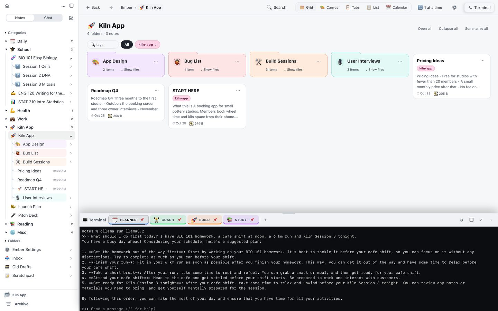
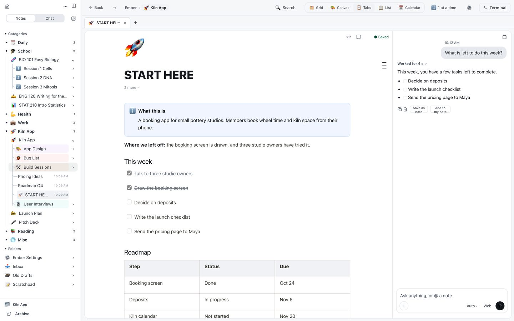
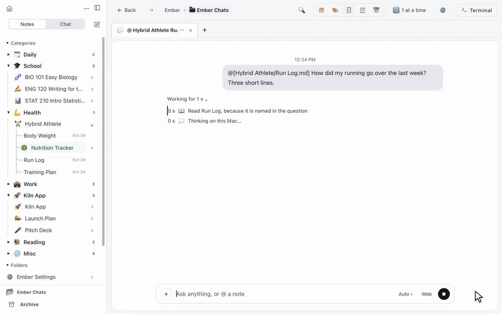
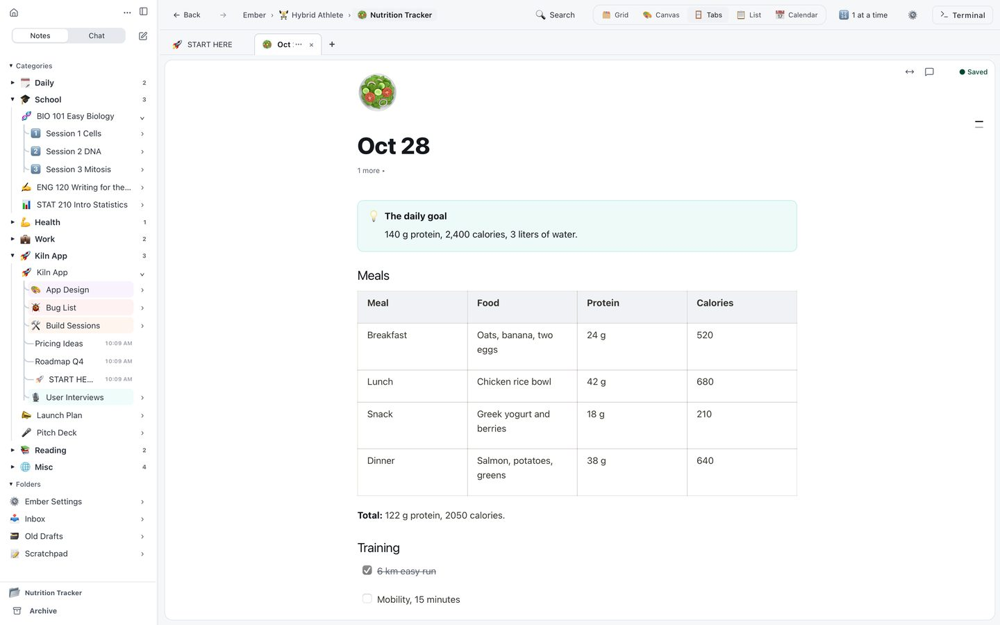
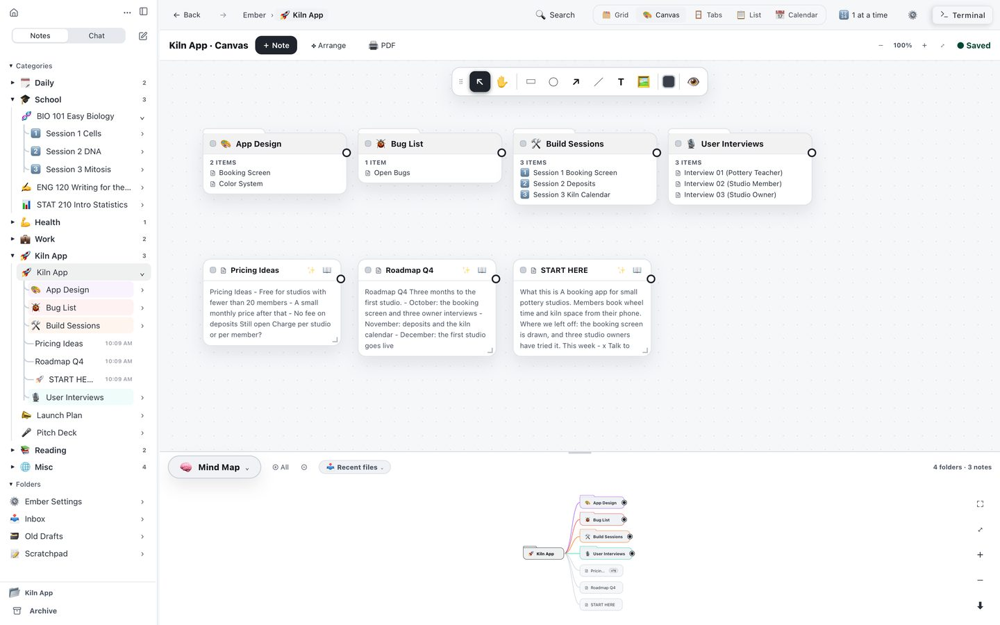

  

<h1 align="center">Ember Notebook</h1>

<b>A memory notebook for all your AI agents.</b>

Ember is a notebook of plain files on your Mac. The AI you sign in with reads the notes you hand it, and writes there.

  <a href="https://github.com/embernotebook/ember/releases/latest/download/Ember.dmg"><b>Download for Mac</b></a>
  &nbsp;&middot;&nbsp;
  <a href="https://embernotebook.com"><b>Website</b></a>
  &nbsp;&middot;&nbsp;
  <a href="https://github.com/embernotebook/ember/releases/latest"><b>What's new</b></a>
  &nbsp;&middot;&nbsp;
  <a href="https://embernotebook.com/privacy.html"><b>Privacy</b></a>
  &nbsp;&middot;&nbsp;
  <a href="SUPPORT.md"><b>Report a problem</b></a>

  

For Apple Silicon Macs (M1 and later) on macOS 14 or later. Free.

**Contents:** [What Ember is](#what-ember-is) &middot; [Pictures](#pictures) &middot; [Install](#install) &middot; [How it works](#how-it-works) &middot; [Privacy](#privacy) &middot; [New in 0.59](#new-in-059) &middot; [Coming next](#coming-next) &middot; [Support](#support) &middot; [License](#license)

## What Ember is

A notebook of plain Markdown files, in a folder you choose on your Mac. The AI you sign in with reads the notes you hand it and writes there: it changes a note when you ask, and shows you what changed.

Your favorite AI runs the way it runs, in a tab beside your notes.

## Pictures

<table>
  <tr>
    <td align="center" width="50%"> A chat can sit beside the note you are writing</td>
    <td align="center" width="50%"> Drag a note into the chat and ask about it. Ember sends that note with your question.</td>
  </tr>
  <tr>
    <td align="center" width="50%"> An eating plan as Ember draws it: a goal callout, a meals table, headings and training ticks.</td>
    <td align="center" width="50%"> Ember's open canvas with note cards, folder cards and its mind map</td>
  </tr>
</table>

## Install

1. Download [Ember for Mac](https://github.com/embernotebook/ember/releases/latest/download/Ember.dmg).
2. Open it and drag Ember into Applications.
3. Open Ember from Applications.

Ember is signed by the developer and notarized by Apple, so it opens like any other app.

Windows is on its way.

## How it works

- **A full terminal, right in your notebook.** Run real commands and the command-line AI tools you already use, next to your notes. No second app, no window to switch to. Drag a note or a file straight into the terminal and keep going.
- **Pick your AI. Your notes stay yours.** Sign in with Claude, ChatGPT, or Google. No keys, no setup. Switch your AI any time in Settings. Or stay on your own Mac with the free Ollama app, even with the Wi-Fi off. The Ollama app reads and answers; changing a note takes Claude, ChatGPT or Gemini. You can also paste an API key in Settings.
- **The notes the AI reads are files you own.** Your notes are plain Markdown files on your Mac, and so is every chat. Open them in any editor, back them up, or read them ten years from now. What Ember's chat is told about you is one note, About You, that you can read and change. Walk away whenever you want. It was always yours.

## Privacy

- Your notes stay in a folder on your Mac. Your notes reach an AI only when you ask for something, or when Ember suggests your next words as you type. Ember has no ads and does not track you.
- Notes the AI reads go to that AI over the internet. With the free Ollama app, no note leaves your Mac.
- The [privacy page](https://embernotebook.com/privacy.html) says what leaves your Mac and when.

## New in 0.59

**A new writing room, with the AI inside it.** Write in blocks and type / for any kind of block. Press Space on an empty line and the AI writes there.

[Everything that's new in 0.59](https://github.com/embernotebook/ember/releases/latest)

## Coming next

Coming soon.

Ember will plug into the apps you already use through connectors, built on MCP, the open standard other AI apps use.

- **Ember Agents**
  - Name a terminal tab today. Next, an agent will work in it from the notes you give it, and act only on your yes.
  - **Planner.** Will draft your day from your notes and calendar.
  - **Coach.** Will check your workouts and meals against your plan.
  - **Build.** Will take your project's next step in the terminal.
- **Connectors**
  - **Google Calendar.** Your day will sit beside your notes.
  - **Gmail.** Nothing will be sent without your yes.
  - More connectors as they come.

## Support

- Found a problem? [Here is how to report it](SUPPORT.md), or write to embernotebook@outlook.com.
- Talk with other people who use Ember on [Discord](https://discord.gg/5ThKWRp7kQ).
- Watch Ember at work on [YouTube](https://www.youtube.com/@embernotebook).

## License

Ember is free to download and use. This repository holds Ember's website and its downloads.

## A note from the maker

I am building Ember on my own. If it earns a place on your Mac, a coffee keeps me going. No pressure at all, and thank you for trying it.

☕ [Buy me a coffee](https://buymeacoffee.com/m.nabeel)

## Created by

**Muhammad Nabeel**
[GitHub](https://github.com/MrNabeel) &middot; [LinkedIn](https://www.linkedin.com/in/mrnabeel1) &middot; [YouTube](https://www.youtube.com/@embernotebook)
